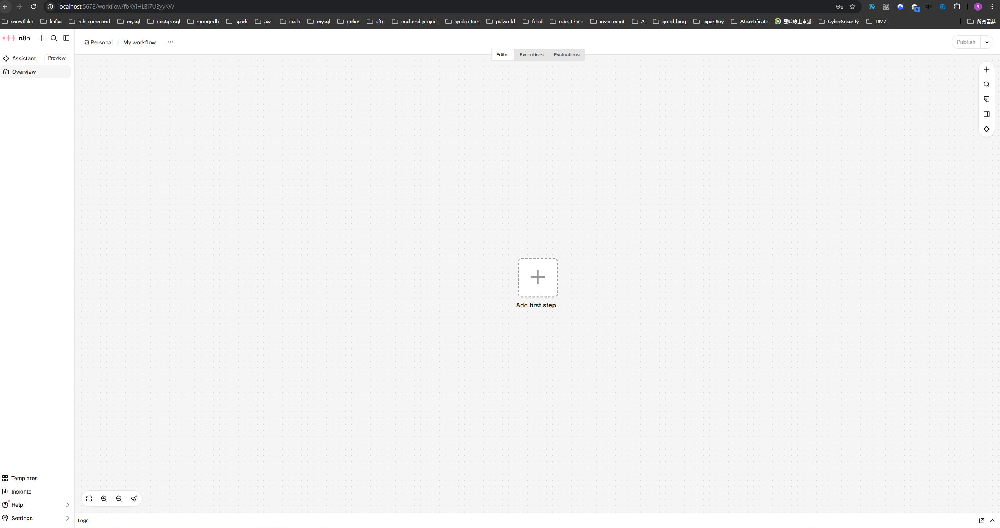
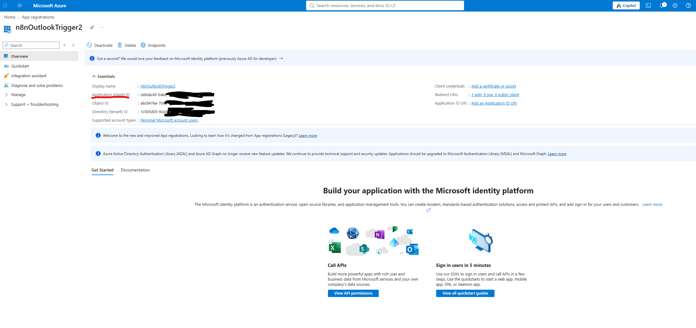
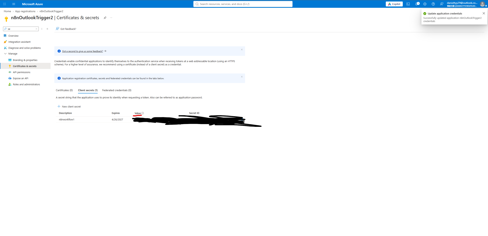
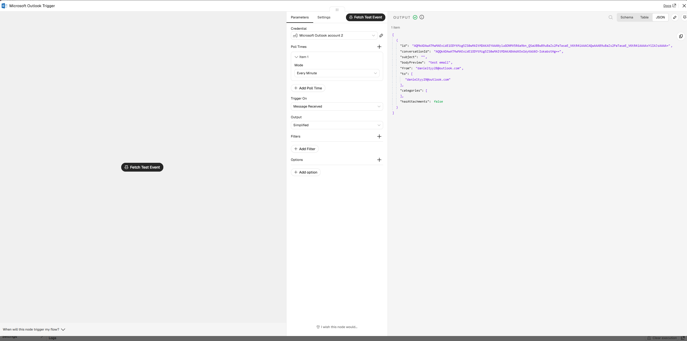
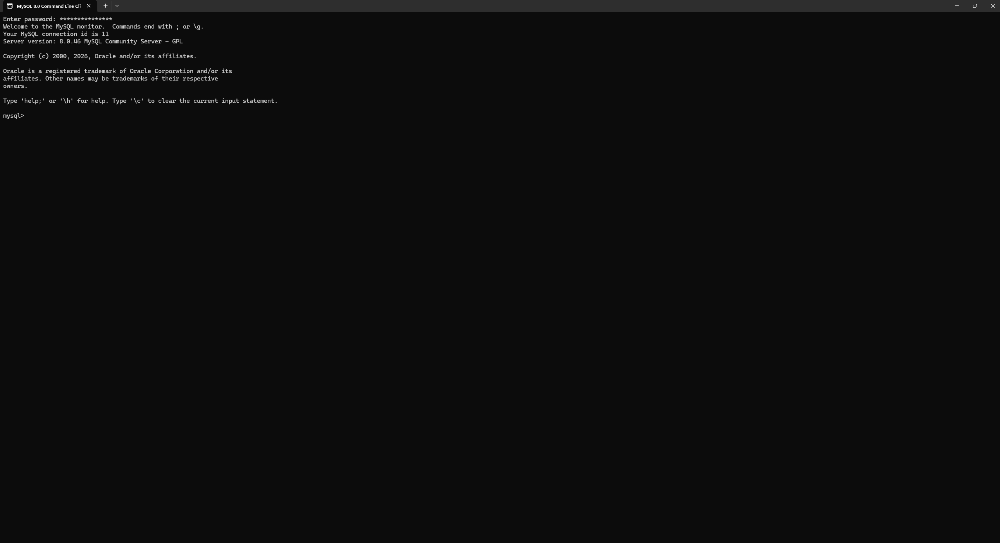
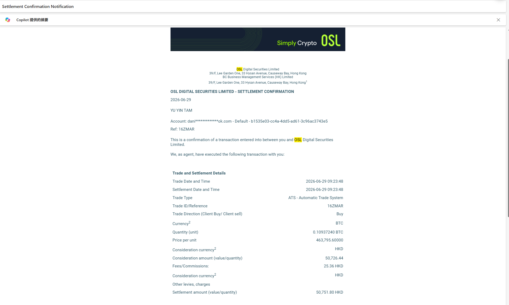

# n8n-Bitcoin-automated-workflow


## 1. Background


## 2. Step by Step

### 2.1 Docker compose

git clone the project, cd to n8n-compose and type 
```bash
mkdir n8n_data
chown -R 1000:1000 n8n_data/
docker compose up
```

Once you have setup your account, create your first workflow


### 2.2 Setup Outlook Event Trigger

To set up event trigger when OSL transaction email received, you need to create a Azure account with that email

Once you have created an Azure account, Create a App Registration in Azure Portal, paste the client id and client secret into Outlook Trigger




If both ID and secret are correctly set, you should able fetch latest email from inputted email address


### 2.3 Install MySQL

Install Link: https://dev.mysql.com/downloads/file/?id=552803


### 2.4 fetch a sample OSL transaction

In 29th June, I have made a transaction in OSL with following details that send to danieltyy28@outlook.com


When fetch using n8n, we got following json
[
    {
        "@odata.etag": "W/\"CQAAABYAAAB9uBaZs2PaTasaE+V6tR4iAADFiYEy\"",
        "id": "AQMkADAwATMwMAExLWE1ODYtMzg5ZS0wMAItMDAKAEYAAANyluGONMV5R6a9bn_QSaUBBwB9uBaZs2PaTasaE_V6tR4iAAACAQwAAAB9uBaZs2PaTasaE_V6tR4iAAAAxYiIAJ8AAAA=",
        "createdDateTime": "2026-10-27T17:24:51Z",
        "lastModifiedDateTime": "2026-10-27T17:24:51Z",
        "changeKey": "CQAAABYAAAB9uBaZs2PaTasaE+V6tR4iAADFiYEy",
        "categories": [],
        "receivedDateTime": "2026-10-27T17:24:51Z",
        "sentDateTime": "2026-10-27T17:24:44Z",
        "hasAttachments": false,
        "internetMessageId": "<LV8PR84MB3584056AD2B8A9F980077040A9602@LV8PR84MB3584.NAMPRD84.PROD.OUTLOOK.COM>",
        "subject": "Settlement Confirmation",
        "bodyPreview": "Trade and Settlement Details\r\nTrade Date and Time\r\n2026-06-29 09:23:48\r\nSettlement Date and Time\r\n2026-06-29 09:23:48\r\nTrade Type\r\nATS - Automatic Trade System\r\nTrade ID/Reference\r\n16ZMAR\r\nTrade Direction (Client Buy/ Client sell)\r\nBuy\r\nCurrency2\r\nBTC\r\nQu",
        "importance": "normal",
        "parentFolderId": "AQMkADAwATMwMAExLWE1ODYtMzg5ZS0wMAItMDAKAC4AAANyluGONMV5R6a9bn_QSaUBAQAAfbgWmbNj2k2rGhPlerUeIgAAAgEMAAAA",
        "conversationId": "AQQkADAwATMwMAExLWE1ODYtMzg5ZS0wMAItMDAKABAAOdw5XRShz0WtnI-TGZPcYg==",
        "conversationIndex": "AQHdZjgAOdw5XRShz0WtnI/TGZPcYg==",
        "isDeliveryReceiptRequested": null,
        "isReadReceiptRequested": false,
        "isRead": false,
        "isDraft": false,
        "webLink": "https://outlook.live.com/owa/?ItemID=AQMkADAwATMwMAExLWE1ODYtMzg5ZS0wMAItMDAKAEYAAANyluGONMV5R6a9bn%2BQSaUBBwB9uBaZs2PaTasaE%2BV6tR4iAAACAQwAAAB9uBaZs2PaTasaE%2BV6tR4iAAAAxYiIAJ8AAAA%3D&exvsurl=1&viewmodel=ReadMessageItem",
        "inferenceClassification": "focused",
        "body": {
            "contentType": "html",
            "content": "<html><head>\r\n<meta http-equiv=\"Content-Type\" content=\"text/html; charset=utf-8\"><style type=\"text/css\" style=\"display:none\">\r\n<!--\r\np\r\n\t{margin-top:0;\r\n\tmargin-bottom:0}\r\n-->\r\n</style></head><body dir=\"ltr\"><table id=\"table_0\" style=\"text-align:left; line-height:14px; width:600px; color:rgb(48,87,102); border-collapse:collapse; border-spacing:0px; box-sizing:border-box\"><tbody><tr><th data-olk-copy-source=\"MessageBody\" style=\"text-align:left; line-height:14px; padding:0.5em\"><div class=\"skipProofing\" style=\"text-align:left; line-height:14px; font-family:Roboto,Arial,sans-serif; font-size:14px; color:rgb(48,87,102)\">Trade and Settlement Details</div></th><th style=\"text-align:left; line-height:14px; padding:0.5em\"></th></tr><tr><td style=\"text-align:left; line-height:14px; padding:0.5em\"><div class=\"skipProofing\" style=\"text-align:left; line-height:14px; font-family:Roboto,Arial,sans-serif; font-size:14px; color:rgb(48,87,102)\">Trade Date and Time</div></td><td style=\"text-align:right; line-height:14px; padding:0.5em\"><div class=\"skipProofing\" style=\"text-align:right; line-height:14px; font-family:Roboto,Arial,sans-serif; font-size:14px; color:rgb(48,87,102)\">2026-06-29 09:23:48</div></td></tr><tr><td style=\"text-align:left; line-height:14px; padding:0.5em\"><div class=\"skipProofing\" style=\"text-align:left; line-height:14px; font-family:Roboto,Arial,sans-serif; font-size:14px; color:rgb(48,87,102)\">Settlement Date and Time</div></td><td style=\"text-align:right; line-height:14px; padding:0.5em\"><div class=\"skipProofing\" style=\"text-align:right; line-height:14px; font-family:Roboto,Arial,sans-serif; font-size:14px; color:rgb(48,87,102)\">2026-06-29 09:23:48</div></td></tr><tr><td style=\"text-align:left; line-height:14px; padding:0.5em\"><div class=\"skipProofing\" style=\"text-align:left; line-height:14px; font-family:Roboto,Arial,sans-serif; font-size:14px; color:rgb(48,87,102)\">Trade Type</div></td><td style=\"text-align:right; line-height:14px; padding:0.5em\"><div class=\"skipProofing\" style=\"text-align:right; line-height:14px; font-family:Roboto,Arial,sans-serif; font-size:14px; color:rgb(48,87,102)\">ATS - Automatic Trade System</div></td></tr><tr><td style=\"text-align:left; line-height:14px; padding:0.5em\"><div class=\"skipProofing\" style=\"text-align:left; line-height:14px; font-family:Roboto,Arial,sans-serif; font-size:14px; color:rgb(48,87,102)\">Trade ID/Reference</div></td><td style=\"text-align:right; line-height:14px; padding:0.5em\"><div class=\"skipProofing\" style=\"text-align:right; line-height:14px; font-family:Roboto,Arial,sans-serif; font-size:14px; color:rgb(48,87,102)\">16ZMAR</div></td></tr><tr><td style=\"text-align:left; line-height:14px; padding:0.5em\"><div class=\"skipProofing\" style=\"text-align:left; line-height:14px; font-family:Roboto,Arial,sans-serif; font-size:14px; color:rgb(48,87,102)\">Trade Direction (Client Buy/ Client sell)</div></td><td style=\"text-align:right; line-height:14px; padding:0.5em\"><div class=\"skipProofing\" style=\"text-align:right; line-height:14px; font-family:Roboto,Arial,sans-serif; font-size:14px; color:rgb(48,87,102)\">Buy</div></td></tr><tr><td style=\"text-align:left; line-height:14px; padding:0.5em\"><div class=\"skipProofing\" style=\"text-align:left; line-height:14px; font-family:Roboto,Arial,sans-serif; color:rgb(48,87,102)\"><span style=\"font-size:14px\">Currency</span><span style=\"font-size:11.2px\">2</span></div></td><td style=\"text-align:right; line-height:14px; padding:0.5em\"><div class=\"skipProofing\" style=\"text-align:right; line-height:14px; font-family:Roboto,Arial,sans-serif; font-size:14px; color:rgb(48,87,102)\">BTC</div></td></tr><tr><td style=\"text-align:left; line-height:14px; padding:0.5em\"><div class=\"skipProofing\" style=\"text-align:left; line-height:14px; font-family:Roboto,Arial,sans-serif; font-size:14px; color:rgb(48,87,102)\">Quantity (unit)</div></td><td style=\"text-align:right; line-height:14px; padding:0.5em\"><div class=\"skipProofing\" style=\"text-align:right; line-height:14px; font-family:Roboto,Arial,sans-serif; font-size:14px; color:rgb(48,87,102)\">0.10937240 BTC</div></td></tr><tr><td style=\"text-align:left; line-height:14px; padding:0.5em\"><div class=\"skipProofing\" style=\"text-align:left; line-height:14px; font-family:Roboto,Arial,sans-serif; font-size:14px; color:rgb(48,87,102)\">Price per unit</div></td><td style=\"text-align:right; line-height:14px; padding:0.5em\"><div class=\"skipProofing\" style=\"text-align:right; line-height:14px; font-family:Roboto,Arial,sans-serif; font-size:14px; color:rgb(48,87,102)\">463,795.60000</div></td></tr><tr><td style=\"text-align:left; line-height:14px; padding:0.5em\"><div class=\"skipProofing\" style=\"text-align:left; line-height:14px; font-family:Roboto,Arial,sans-serif; color:rgb(48,87,102)\"><span style=\"font-size:14px\">Consideration currency</span><span style=\"font-size:11.2px\">2</span></div></td><td style=\"text-align:right; line-height:14px; padding:0.5em\"><div class=\"skipProofing\" style=\"text-align:right; line-height:14px; font-family:Roboto,Arial,sans-serif; font-size:14px; color:rgb(48,87,102)\">HKD</div></td></tr><tr><td style=\"text-align:left; line-height:14px; padding:0.5em\"><div class=\"skipProofing\" style=\"text-align:left; line-height:14px; font-family:Roboto,Arial,sans-serif; font-size:14px; color:rgb(48,87,102)\">Consideration amount (value/quantity)</div></td><td style=\"text-align:right; line-height:14px; padding:0.5em\"><div class=\"skipProofing\" style=\"text-align:right; line-height:14px; font-family:Roboto,Arial,sans-serif; font-size:14px; color:rgb(48,87,102)\">50,726.44</div></td></tr><tr><td style=\"text-align:left; line-height:14px; padding:0.5em\"><div class=\"skipProofing\" style=\"text-align:left; line-height:14px; font-family:Roboto,Arial,sans-serif; font-size:14px; color:rgb(48,87,102)\">Fees/Commissions:</div></td><td style=\"text-align:right; line-height:14px; padding:0.5em\"><div class=\"skipProofing\" style=\"text-align:right; line-height:14px; font-family:Roboto,Arial,sans-serif; font-size:14px; color:rgb(48,87,102)\">25.36 HKD</div></td></tr><tr><td style=\"text-align:left; line-height:14px; padding:0.5em\"><div class=\"skipProofing\" style=\"text-align:left; line-height:14px; font-family:Roboto,Arial,sans-serif; color:rgb(48,87,102)\"><span style=\"font-size:14px\">Consideration currency</span><span style=\"font-size:11.2px\">2</span></div></td><td style=\"text-align:right; line-height:14px; padding:0.5em\"><div class=\"skipProofing\" style=\"text-align:right; line-height:14px; font-family:Roboto,Arial,sans-serif; font-size:14px; color:rgb(48,87,102)\">HKD</div></td></tr><tr><td style=\"text-align:left; line-height:14px; padding:0.5em\"><div class=\"skipProofing\" style=\"text-align:left; line-height:14px; font-family:Roboto,Arial,sans-serif; font-size:14px; color:rgb(48,87,102)\">Other levies, charges</div></td><td style=\"text-align:right; line-height:14px; padding:0.5em\"></td></tr><tr><td style=\"text-align:left; line-height:14px; padding:0.5em\"><div class=\"skipProofing\" style=\"text-align:left; line-height:14px; font-family:Roboto,Arial,sans-serif; font-size:14px; color:rgb(48,87,102)\">Settlement amount (value/quantity)</div></td><td style=\"text-align:right; line-height:14px; padding:0.5em\"><div class=\"skipProofing\" style=\"text-align:right; line-height:14px; font-family:Roboto,Arial,sans-serif; font-size:14px; color:rgb(48,87,102)\">50,751.80 HKD</div></td></tr></tbody></table><div class=\"elementToProof\" style=\"font-family:Aptos,Aptos_EmbeddedFont,Aptos_MSFontService,Calibri,Helvetica,sans-serif; font-size:12pt; color:rgb(0,0,0)\"><br></div></body></html>"
        },
        "sender": {
            "emailAddress": {
                "name": "Tam Yu Yin",
                "address": "danieltyy28@outlook.com"
            }
        },
        "from": {
            "emailAddress": {
                "name": "Tam Yu Yin",
                "address": "danieltyy28@outlook.com"
            }
        },
        "toRecipients": [
            {
                "emailAddress": {
                    "name": "danieltyy29@outlook.com",
                    "address": "danieltyy29@outlook.com"
                }
            }
        ],
        "ccRecipients": [],
        "bccRecipients": [],
        "replyTo": [],
        "flag": {
            "flagStatus": "notFlagged"
        }
    }
]

All the key info is store in Body field, so next step we need to extract this field

### 2.5 Data Cleansing

Filter only Body field and parse the html to extract the key information
Apply following javascript code
```javascript
const body = $input.first().json.body;

const matches = [...body.matchAll(
  /<td.*?>(.*?)<\/td>\s*<td.*?>(.*?)<\/td>/gs
)];

const result = {};

for (const match of matches) {

  const key = match[1]
    .replace(/<[^>]*>/g, '')
    .trim();

  const value = match[2]
    .replace(/<[^>]*>/g, '')
    .trim();

  result[key] = value;
}

return [
  {
    json: result
  }
];
```

After that, you should get the json as follows
[
    {
        "Trade Date and Time": "2026-06-29 09:23:48",
        "Settlement Date and Time": "2026-06-29 09:23:48",
        "Trade Type": "ATS - Automatic Trade System",
        "Trade ID/Reference": "16ZMAR",
        "Trade Direction (Client Buy/ Client sell)": "Buy",
        "Currency2": "BTC",
        "Quantity (unit)": "0.10937240 BTC",
        "Price per unit": "463,795.60000",
        "Consideration currency2": "HKD",
        "Consideration amount (value/quantity)": "50,726.44",
        "Fees/Commissions:": "25.36 HKD",
        "Other levies, charges": "",
        "Settlement amount (value/quantity)": "50,751.80 HKD"
    }
]

Adjust the data type of each field and remove unnessary field, the final json will be this
[
    {
        "transacttime": "2026-06-29 09:23:48",
        "orderid": "16ZMAR",
        "side": "Buy",
        "symbol": "BTCHKD",
        "orderqty": 0.1093724,
        "bitprice": 463795.6,
        "turnover": 50726.44,
        "handling_fee": 25.36,
        "settlement_amount": 50751.8
    }
]

### 2.6 Create Schema and connect mysql in n8n


in mysql(hosted on my local machine), execute below SQL command to create schema for new table bitcoin_transactions
CREATE TABLE bitcoin_transactions (
    id BIGINT AUTO_INCREMENT PRIMARY KEY,

    orderid VARCHAR(50) NOT NULL,
    side ENUM('BUY','SELL') NOT NULL,

    symbol VARCHAR(20) NOT NULL,

    transacttime DATETIME NOT NULL,
    settlementtime DATETIME,

    orderqty DECIMAL(18,8) NOT NULL,
    bitprice DECIMAL(18,2) NOT NULL,

    turnover DECIMAL(18,2) NOT NULL,
    handling_fee DECIMAL(18,2) DEFAULT 0,

    trade_type VARCHAR(100),
    consideration_currency VARCHAR(10),

    pair_id BIGINT NULL,
    sold_percentage DECIMAL(5,2) DEFAULT 0,

    created_at TIMESTAMP DEFAULT CURRENT_TIMESTAMP,

    UNIQUE KEY uk_orderid (orderid),
    INDEX idx_transacttime (transacttime),
    INDEX idx_side (side),
    INDEX idx_symbol (symbol)
);

Insert the cleansed record to newly created table

Final Result
